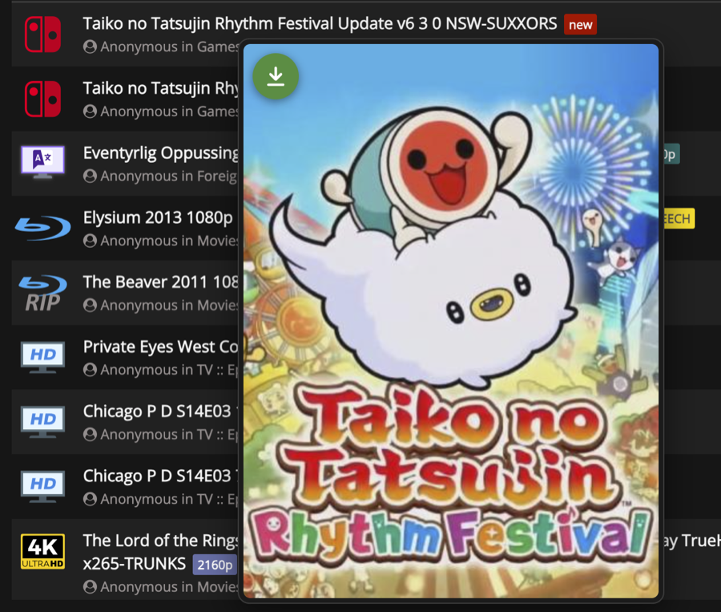

<a href="README.md">Português</a> · <b>English</b> · <a href="README.es.md">Español</a>

# Prévia Torrent

A **Chrome** extension and **Firefox** userscript that shows a **torrent's image when you hover over its link**, without opening the page. The popup has a **download arrow** that grabs the `.torrent` right away, and clicking the image **enlarges** it over the page.

| Site | What the popup shows |
|---|---|
| TorrentLeech | the movie, show or game poster |
| PussyTorrents | the "Covers & Screens" image at full size (the same one that opens when you click the thumbnail) |

You need to be logged in to the site: the extension uses the login already in your browser.

## How to use

- **Rest the mouse** on a torrent name: in the list, in search results or on any page of the site. After a moment a popup shows the image.
- **Green arrow** (top-left corner): downloads the `.torrent`.
- **Click the image** to enlarge it. Click again or press `Esc` to close. `⌘`/`Ctrl` + click opens the image in a new tab.
- The popup stays where it opened, so you can move the mouse to the arrow. It closes when you move the mouse away, press `Esc` or scroll the page.
- Sweeping the mouse quickly across links opens nothing. A torrent without an image shows "Sem imagem" (no image), with the arrow next to it.

## Install on Firefox

On Firefox, Prévia Torrent is a **userscript** that runs inside a userscript manager.

1. Install a userscript manager: **[Violentmonkey](https://addons.mozilla.org/firefox/addon/violentmonkey/)** (recommended), [Tampermonkey](https://addons.mozilla.org/firefox/addon/tampermonkey/) or [Greasemonkey](https://addons.mozilla.org/firefox/addon/greasemonkey/).
2. Click **[install Prévia Torrent](https://raw.githubusercontent.com/dmanske/ExtensaoTorrent-Publico/main/dist/previa-torrent.user.js)**. The manager opens its install screen; confirm.
3. Open (or reload) the site's torrent list and rest the mouse on a name.

If the link doesn't open the install screen: open [`dist/previa-torrent.user.js`](dist/previa-torrent.user.js), copy all of it, create a **new script** in the manager (in Greasemonkey: monkey icon → "New user script…"), paste it over the template and save.

## Install on Chrome

1. Download `PreviaTorrent-<version>-Chrome.zip` from **[Releases](https://github.com/dmanske/ExtensaoTorrent-Publico/releases/latest)** and unzip it. Keep the folder in a permanent place: Chrome runs it from there, and if it is deleted or moved the extension stops working.
2. Open `chrome://extensions`.
3. Turn on **Developer mode** (top-right corner).
4. Click **Load unpacked** and choose the unzipped folder (the one with `manifest.json`).
5. Open (or reload) the site's torrent list.

## Update

- **Firefox:** Violentmonkey and Tampermonkey fetch new versions on their own. In Greasemonkey, click the install link again.
- **Chrome:** download the new zip, replace the folder's contents and click ↻ on the extension in `chrome://extensions`.

## How it works

1. When you rest the mouse on a torrent link for 0.3 seconds, the extension fetches that torrent's page **in the background, without opening it**, using the login already in your browser.
2. From that page it takes two addresses: the **image** and the `.torrent` **download**.
3. It shows the image in a popup next to the mouse, with the arrow pointing to the download.
4. It remembers the result while the tab is open: hovering the same torrent again opens instantly.

**Privacy:** the extension sends nothing anywhere. It only talks to the site itself (the torrent page) and its image server; it has no server of its own, collects no data and asks for no extra permissions. It fetches one page only when you rest the mouse on a link, never the whole list at once: the same as you opening the page.

## Troubleshooting

| What happens | What to do |
|---|---|
| No popup at all | Check that the extension or script is enabled and reload the site's page. |
| "Sem imagem" (no image) | That torrent has no image on the site (common for games and some episodes). The arrow still works. |
| "o site pediu login de novo" (the site asked for login again) | Your session on the site expired: log in again. |
| "Não deu para abrir a página" (couldn't open the page) | The site didn't respond; try again. On Firefox, if it keeps happening, switch the manager to Violentmonkey. |
| Suddenly stopped working | The site may have changed its page. Open an [issue](https://github.com/dmanske/ExtensaoTorrent-Publico/issues). |

## License

[MIT](LICENSE).
